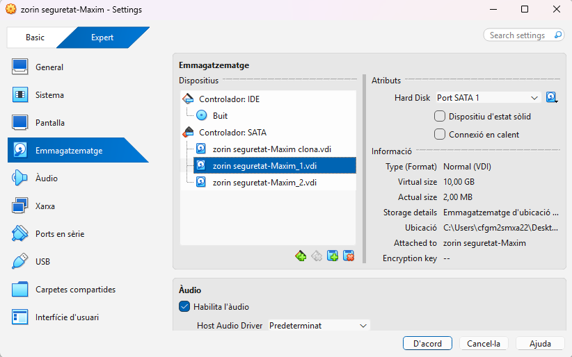
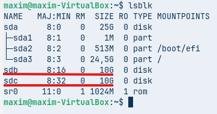
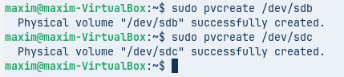
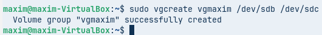
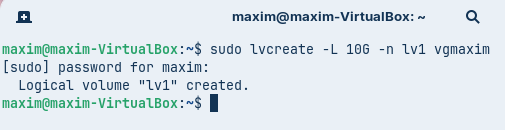

# NF2AA2-GestioDiscos

1. LVM amb Zorin OS
S'ha d'utilitzar la distribució Zorin OS (o una alternativa Linux compatible) per demostrar la utilitat del Logical Volume Manager (LVM).

Requisits de la Implementació i Demostració:

* Configuració Inicial: Crear un grup de volums (VG) i un volum lògic (LV) utilitzant inicialment un mínim de dos discs durs de 10 GB de capacitat. Aquest volum haurà estar formatat i muntat automàticament al sistema mitjançant l’edició de l’arxiu /etc/fstab.



Aqui creem dos discs de **10GB** a la maquina virtual Linux.



**Amb la comanda:**
```bash 
lsblk
```
comprovem que els discs estiguin creats.



**Amb les comandes:**
```bash
sudo pvcreate /dev/sdb
sudo pvcreate /dev/sdc
```
passem els discos virtuals que hem creat a discos físics.



**Amb els discs físics ja creats fem servir la comanda:**
```bash
sudo vgcreate vg1 /dev/sdb /dev/sdc
```
per aixi crear el nostre grup de volums lògics.



**Ara el disc físic que hem fet el transformem a lògic amb la comanda:**
```bash
sudo lvcreate -L 10G -n lv1 vg1
```

* Alta Disponibilitat: Implementar la configuració d’un mirall (lvm_mirror) que protegeixi la informació davant la fallada d'un disc.


* Instantànies (snapshots): Crear i afegir dos discos de 10 GB al grup de volums. Crear un volum (lvm_dades) amb el primer disc afegit, formatar-lo i muntar-lo. A continuació afegir arxius al volum (poden ser imatges d’Internet). Usar el segon disc afegit per crear un snapshot (lv_snapshot) i documentar com es pot restaurar aquest snapshot, si per exemple, la informació del volum original es danyés.

* Escalabilitat: Demostrar el procés d'ampliació. Usar l’espai que quedi lliure dins el grup de volums per ampliar el volum lv_dades.

2. Espais d'emmagatzematge a Windows 11
S'ha d'utilitzar Windows 11 per demostrar les configuracions possibles mitjançant els Espais d'Emmagatzematge (Storage Spaces).

Requisits de la Implementació i Demostració:

* Configuració inicial: Creació d'un Storage Pool: Crear un pool d'emmagatzematge inicialment amb tres discos de 10 GB (simulats).

* Estudi de Configuracions: Demostrar i documentar la creació d'un Espai d'Emmagatzematge utilitzant:

    * Resiliència de Mirall (Mirroring): Usar dos dels discos. Comprovar que ofereix alta disponibilitat.
    * Resiliència de Paritat (Parity): Explicant la seva eficiència d'espai en comparació amb el mirall. Cal usar els tres discos.
    * Resiliència de mirall triple. Afegir tant discos de 10 GB com siguin necessaris.
    * Demostració de la Gestió: Mostrar com es visualitza l'estat dels discos i del pool des de la consola de gestió de Windows, simulant la facilitat de manteniment.